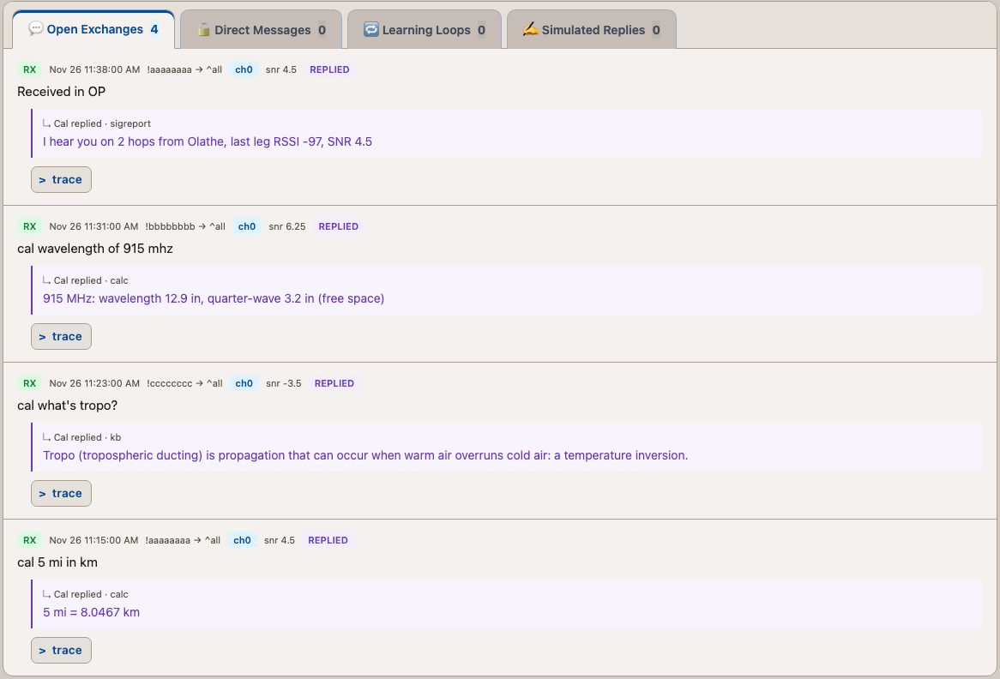
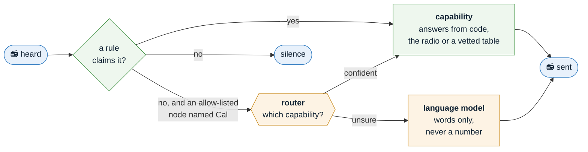
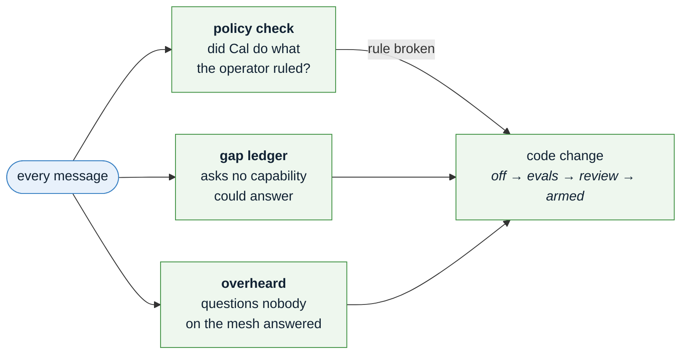

# cal-mesh

**An AI station on a Meshtastic radio mesh.** Ask it something over LoRa and it answers on air,
from code and the radio's own measurements first, and a language model only as a last resort.



<sub>The public dashboard. Illustrative data with placeholder node ids; the replies are produced
by Cal's real code.</sub>

> One operator's station, shared so you can build your own. It runs every day; it is not a
> product. Forks and issues welcome.

## How a message gets answered



Green is plain code, amber involves a model. **Every number on air comes from code or the
radio.** Every reply's decision trace is public, and anything a capability can't verify gets
"I don't know" rather than a guess.

## What Cal answers

| Ask | Answer comes from | Who |
|---|---|---|
| Range test, check-in, "Received in OP" | the radio's measured hops, RSSI and SNR | anyone |
| Sunset, twilight, moon | computed locally, works offline | anyone who names Cal |
| Maths, units, RF ("wavelength of 915 MHz") | computed locally | anyone who names Cal |
| Radio terms ("what's tropo?") | a vetted table, every entry sourced | anyone who names Cal |
| "What can you do?" | the live config | anyone who names Cal |
| Current weather | fetched from NWS; the model only words it | allow-listed nodes |
| Anything else | a language model with no tools and no private context | allow-listed nodes |

Every capability ships switched off and is armed only after 40 eval suites and an independent
adversarial review. Details and the refusals: [`docs/capabilities.md`](docs/capabilities.md).

## How it learns



No human grading. Cal's behaviour is checked against a few standing rulings from the operator
(for example: a tapback gets silence, a check-in gets a signal report), and a broken ruling points
at the code to fix. A health strip says whether the loop is running, failing or simply has
nothing to learn from. → [`docs/learning.md`](docs/learning.md)

## Run it

Needs a Meshtastic radio over USB or its TCP API, macOS or Linux, and Python 3.12+.

```bash
git clone https://github.com/deanssamclaw/cal-mesh.git ~/cal-mesh && cd ~/cal-mesh
python3 -m venv .venv && .venv/bin/pip install -r requirements.txt
cp config.example config          # set TRANSPORT and ALLOW_FROM; leave RESPONDER_ENABLED=false
./run-evals.sh                    # GREEN means your setup works (~3 min)
```

Then start the services in [`deploy/`](deploy) and watch traffic with `./mesh watch`. Leave the
responder off for a week first: `decisions.jsonl` shows what your mesh asks and what Cal would
have said. `RESPONDER_ENABLED=false` is the master off switch, and the config is re-read live.

## Docs

[Design essay](docs/design-essay.md) · [Capabilities](docs/capabilities.md) ·
[Learning loop](docs/learning.md) · [Addressing](docs/addressing.md) ·
[Trace & privacy](docs/trace-and-privacy.md) · [Router](docs/router.md) ·
[Operations](docs/operations.md) · [Proposals](docs/proposals)

## Credits & license

Built on [Meshtastic](https://meshtastic.org). Local routing uses
[SemIf](https://github.com/TheoLeeCJ/SemIf-OpenJev) with
[Qwen3.5-4B](https://huggingface.co/Qwen/Qwen3.5-4B), with [TypeSafe AI](https://typesafe.ai)'s
Jev as the cloud backup. Weather from [NOAA / NWS](https://www.weather.gov).

[GPL-3.0](LICENSE), like Meshtastic. © 2026 deanssamclaw. Dependencies keep their own licenses;
model weights are downloaded separately and are not part of this repo.
